# cli-manager — руководство пользователя

**cli-manager** — конструктор составных shell-команд. Вы описываете команды
в удобном интерфейсе (терминальном или веб), а утилита генерирует готовый
скрипт для **zsh** или **bash**: shell-функции, встроенную справку и
автодополнение.

```
av db migrate up
│  │  │       └── подкоманда (лист с действием)
│  │  └────────── подкоманда-ветвь
│  └───────────── команда-ветвь
└──────────────── префикс (shell-функция)
```

> Все скриншоты сняты на демонстрационном конфиге из раздела
> [«Пример конфигурации»](#14-пример-конфигурации).

## Содержание

1. [Основные понятия](#1-основные-понятия)
2. [Установка и первый запуск](#2-установка-и-первый-запуск)
3. [Терминальный интерфейс (TUI)](#3-терминальный-интерфейс-tui)
   - [Главное меню](#31-главное-меню)
   - [Префиксы](#32-префиксы)
   - [Команды и подкоманды](#33-команды-и-подкоманды)
   - [Флаги](#34-флаги)
   - [Формы и живые проверки](#35-формы-и-живые-проверки)
   - [Тестовый запуск и внешний редактор](#36-тестовый-запуск-и-внешний-редактор)
   - [Глобальные переменные](#37-глобальные-переменные)
   - [Поиск](#38-поиск)
   - [Выключение, дублирование, удаление, порядок, отмена](#39-выключение-дублирование-удаление-порядок-отмена)
   - [Импорт alias из rc-файла](#310-импорт-alias-из-rc-файла)
   - [Предпросмотр скрипта](#311-предпросмотр-скрипта)
   - [Выбор оболочки](#312-выбор-оболочки-zsh--bash)
   - [Справка по клавишам](#313-справка-по-клавишам)
4. [Веб-интерфейс (`cli-manager ui`)](#4-веб-интерфейс-cli-manager-ui)
5. [Командная строка](#5-командная-строка)
6. [Как работает сгенерированный скрипт](#6-как-работает-сгенерированный-скрипт)
7. [Флаги: замена или дополнение действия](#7-флаги-замена-или-дополнение-действия)
8. [Контекстные условия](#8-контекстные-условия-condition)
9. [Аргументы команд](#9-аргументы-команд)
10. [Проверки и защита от ошибок](#10-проверки-и-защита-от-ошибок)
11. [Файлы и их расположение](#11-файлы-и-их-расположение)
12. [Ручная правка конфига](#12-ручная-правка-конфига)
13. [Справочник полей конфигурации](#13-справочник-полей-конфигурации)
14. [Пример конфигурации](#14-пример-конфигурации)
15. [Частые вопросы и решение проблем](#15-частые-вопросы-и-решение-проблем)

---

## 1. Основные понятия

| Понятие | Что это | Пример |
|---|---|---|
| **Префикс** | Корневая команда. Становится shell-функцией | `av`, `gx` |
| **Команда** | Подкоманда префикса. Бывает листом или ветвью | `av note`, `av db` |
| **Лист** | Команда с действием `run` и, возможно, флагами | `av deploy` |
| **Ветвь** | Команда с подкомандами (как `git remote add`), вложенность любой глубины | `av db migrate up` |
| **Флаг** | Опция команды-листа со своим действием | `av deploy --force` |
| **Действие (`run`)** | Bash-код, который выполняется при вызове | `docker-compose up -d` |
| **Глобальная переменная** | `export` в начале скрипта, доступна во всех действиях | `VAULT_DIR` |
| **Условие (`condition`)** | Bash-выражение: команда видна в справке и автодополнении, только если оно истинно | `[[ -f docker-compose.yml ]]` |

Префикс, команду и флаг можно **выключить**: они остаются в конфиге, но в скрипт
не попадают.

---

## 2. Установка и первый запуск

Нужен **Go 1.23+** для сборки и **zsh** или **bash** как целевая оболочка
(bash также нужен для проверок синтаксиса и тестового запуска).

```bash
make install
```

```bash
cli-manager init
```

1. `make install` собирает бинарник с версией из `git describe` и кладёт его
   в `$(go env GOPATH)/bin`.
2. `cli-manager init` один раз дописывает в конец `~/.zshrc` (или `~/.bashrc`)
   блок подключения сгенерированного скрипта — с подтверждением и бэкапом `.bak`.
3. Запустите `cli-manager` без аргументов — откроется TUI. Или
   `cli-manager ui` — веб-интерфейс в браузере.

Проверить, что всё настроено, можно командой `cli-manager doctor`:

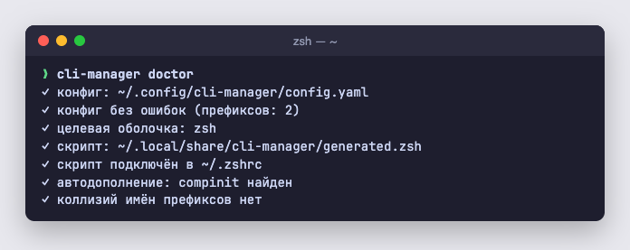

> Для автодополнения в zsh нужна инициализированная система completion
> (`autoload -Uz compinit && compinit`), а подключение cli-manager должно стоять
> **после** неё. `init` дописывает блок в конец файла, а `doctor` проверяет
> порядок (compinit, вызванный oh-my-zsh, prezto, zinit, zimfw, antidote,
> antigen или zplug, тоже засчитывается).

---

## 3. Терминальный интерфейс (TUI)

Запуск: `cli-manager` (или `make run` при разработке). При каждом запуске
скрипт перегенерируется, чтобы улучшения генератора попадали в него без
правки конфига.

### 3.1. Главное меню

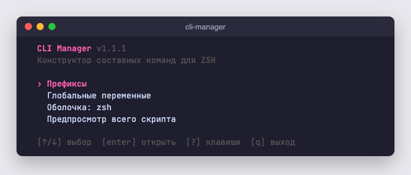

| Пункт | Что делает |
|---|---|
| **Префиксы** | Список префиксов → команды → подкоманды → флаги |
| **Глобальные переменные** | Словарь `ключ → значение`, экспортируется в скрипт |
| **Оболочка: zsh / bash** | Переключает целевую оболочку (`Enter`) |
| **Предпросмотр всего скрипта** | Весь сгенерированный код |

`↑/↓` (или `j/k`) — выбор, `Enter` — открыть, `?` — все клавиши, `q` — выход.

Под меню выводятся предупреждения:

- **⚠ В конфиге проблем: N** — если конфиг правили вручную и в нём ошибки
  (подробности — `cli-manager doctor`);
- **⚠ Скрипт не подключён к ~/.zshrc** — если не выполнен `cli-manager init`.

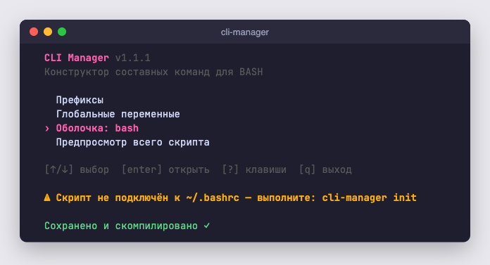

### 3.2. Префиксы

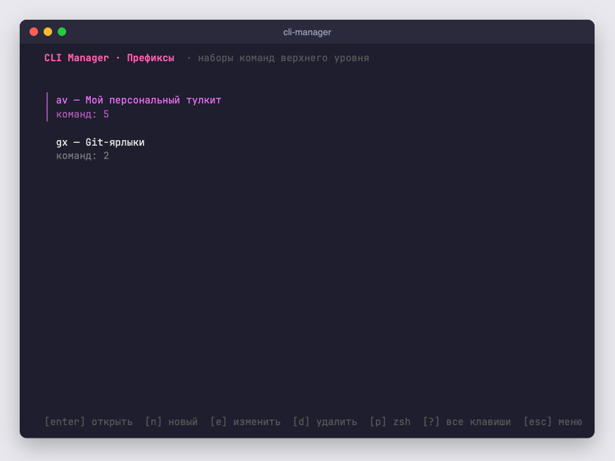

Каждая строка — имя и описание префикса, ниже — число команд.

| Клавиша | Действие |
|---|---|
| `Enter` | открыть команды префикса |
| `n` | новый префикс |
| `e` | изменить имя и описание |
| `d` | удалить (с подтверждением) |
| `x` | выключить / включить |
| `c` | дублировать (со всеми командами) |
| `K` / `J`, `Shift+↑/↓` | переместить выше / ниже |
| `p` | предпросмотр кода этого префикса |
| `i` | импорт alias из rc-файла |
| `u` | отменить последнее изменение |
| `/` | поиск |
| `Esc` | в главное меню |

Имя префикса становится именем shell-функции, поэтому допускаются только
буквы, цифры и `_` (первый символ — буква или `_`).

### 3.3. Команды и подкоманды

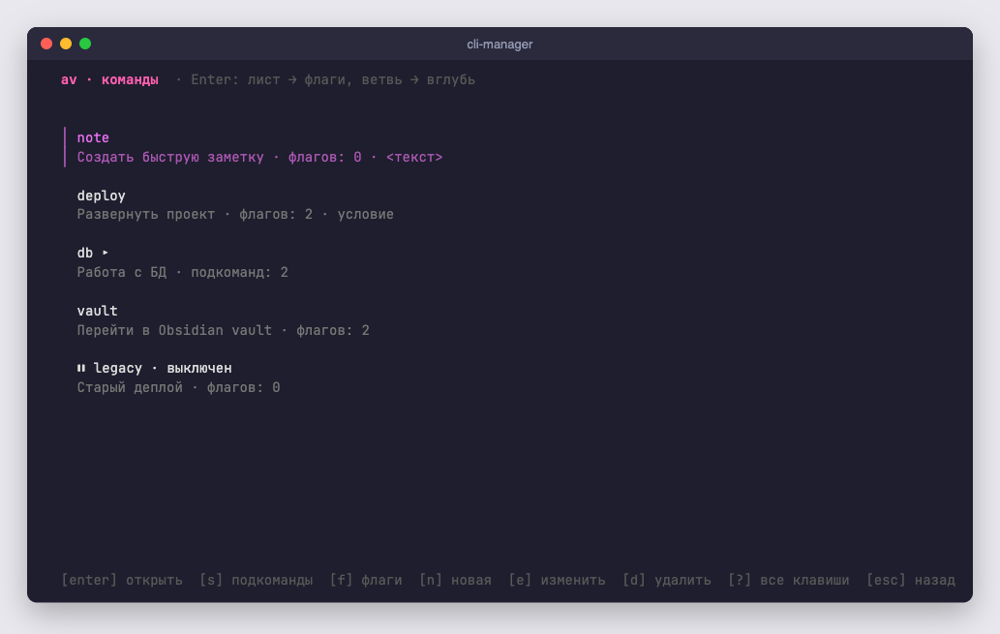

Под именем команды — описание и сводка:

- `флагов: N` или `подкоманд: N`;
- `<текст>` — описание аргументов из поля `usage`;
- `принимает аргументы` — у команды включён проброс `$@` (если `usage` пуст);
- `условие` — задано контекстное условие;
- `▸` после имени — это ветвь (есть подкоманды);
- `⏸ … · выключен` — команда выключена.

Навигация по дереву:

| Клавиша | Действие |
|---|---|
| `Enter` | лист → его флаги; ветвь → её подкоманды |
| `s` или `→` | войти в подкоманды (в том числе чтобы начать вложенность у листа) |
| `f` | открыть флаги команды явно |
| `Esc` | на уровень выше |

Заголовок экрана показывает текущий путь — «хлебные крошки»:

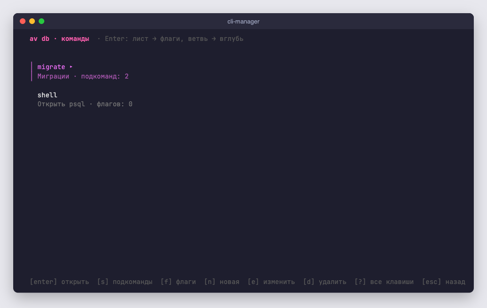

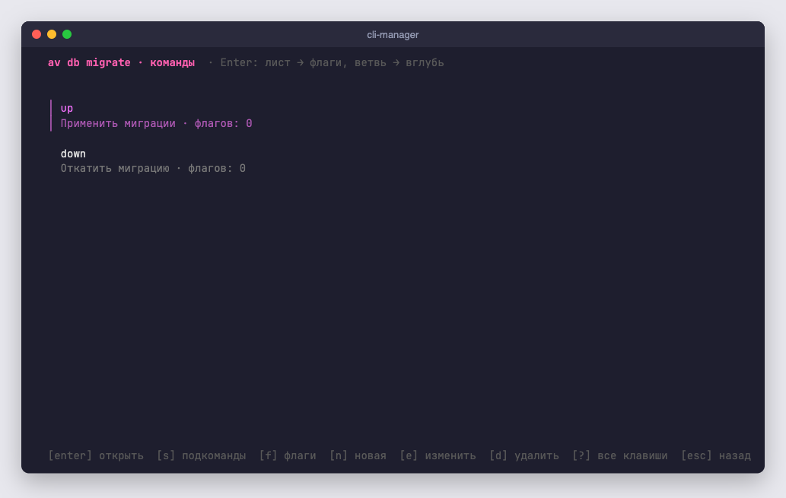

У ветви могут быть и подкоманды, и флаги: `av mb loc profile` и
`av mb --profile` работают одновременно (флаги ветви открываются по `f`).
Флаг с `after_command` сначала выполняет `run` ветви. Если имя флага совпадает
с подкомандой, срабатывает подкоманда — об этом сообщают `doctor`, главное
меню TUI и веб-интерфейс.
`run` ветви выполняется без подкоманды (`av mb`) и если подкоманда не
распознана.

### 3.4. Флаги

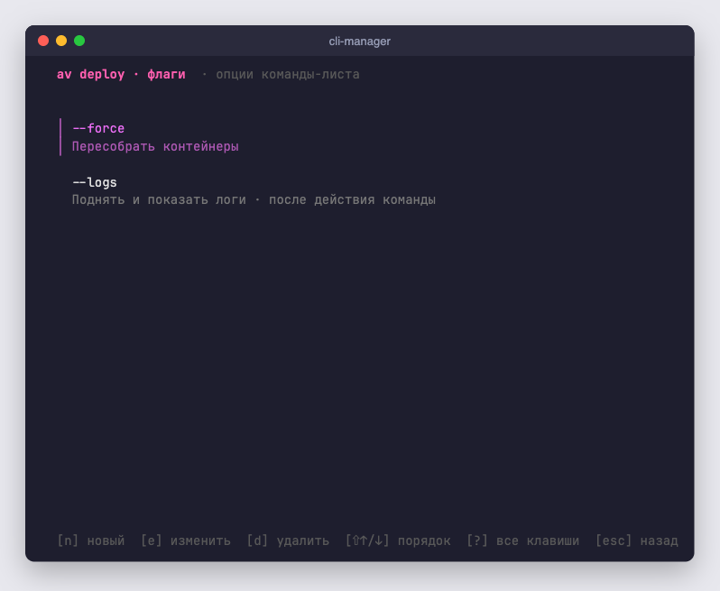

Флаг — опция команды-листа со своим действием. Имя флага — например `--force`,
`-f` или просто `build`. Подпись `после действия команды` означает, что у флага
включён режим `after_command` (см. [раздел 7](#7-флаги-замена-или-дополнение-действия)).

### 3.5. Формы и живые проверки

Формы открываются по `n` (создание) и `e` (правка). `Enter` переходит к
следующему полю, на последнем — сохраняет; `Esc` закрывает форму без
сохранения. В заголовке видно, где в дереве создаётся элемент.

**Форма команды:**

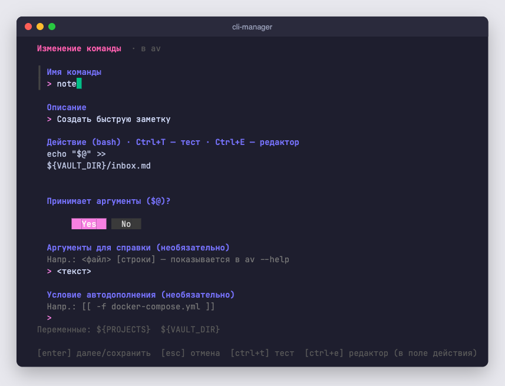

| Поле | Назначение |
|---|---|
| Имя команды | буквы, цифры, `_` и `-`; уникально на своём уровне |
| Описание | показывается в справке и автодополнении |
| Действие (bash) | многострочный bash-код |
| Принимает аргументы (`$@`)? | пробрасывать ли аргументы в действие |
| Аргументы для справки | например `<файл> [строки]`, выводится в `av --help` |
| Условие автодополнения | bash-выражение, см. [раздел 8](#8-контекстные-условия-condition) |

Под формой — подсказка со списком глобальных переменных (`${VAULT_DIR}` …),
чтобы не держать их в голове.

**Форма флага:**

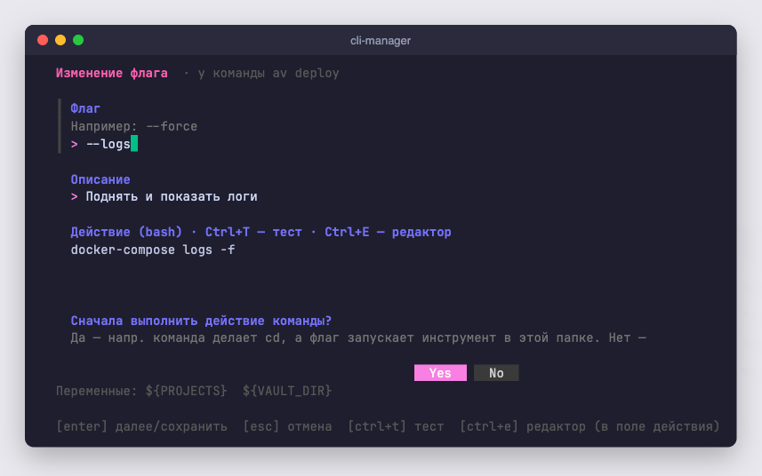

**Проверки прямо во время ввода:**

- Имя проверяется на формат и уникальность — ошибка не даст сохранить форму.
- Поле действия проверяется через `bash -n` — **код не выполняется**,
  только разбирается синтаксис:

  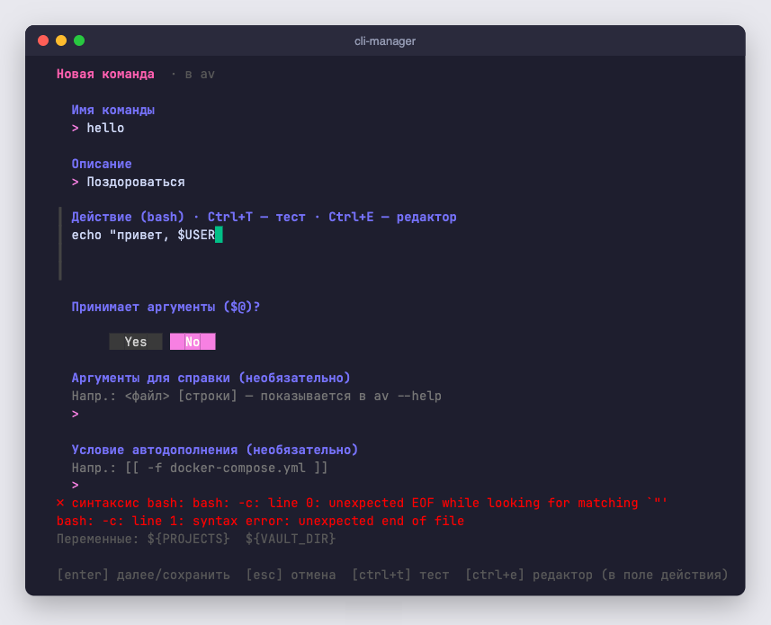

  Ошибка синтаксиса не блокирует ввод. Если сохранить команду с ошибкой,
  конфиг запишется, но скрипт не обновится, пока ошибку не исправить, —
  статус-строка покажет причину.

- Имя префикса проверяется на **коллизии**: префикс — это функция, и она
  перекроет системную команду с тем же именем…

  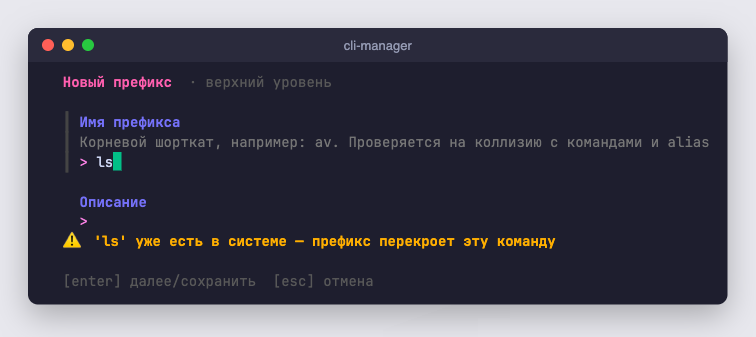

  …а alias с тем же именем, наоборот, перекроет префикс:

  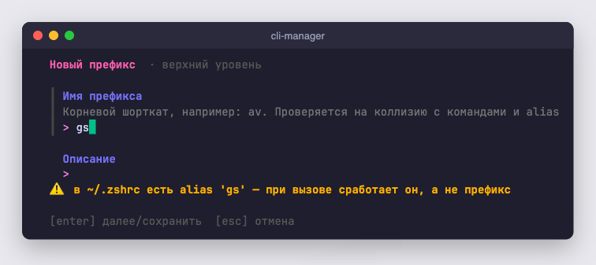

  Это предупреждение, а не ошибка: сохранить такой префикс можно.

### 3.6. Тестовый запуск и внешний редактор

**`Ctrl+T`** в форме команды или флага **выполняет** bash-код из поля действия
и показывает stdout/stderr:

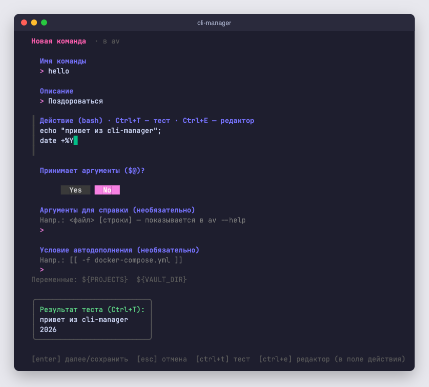

> ⚠️ `Ctrl+T` реально выполняет код в текущем окружении. Не тестируйте так
> деструктивные команды (`rm`, `git push --force` и т. п.).

**`Ctrl+E`** (когда фокус в поле действия) открывает код во внешнем редакторе:
`$VISUAL`, затем `$EDITOR`, иначе `nano`. После закрытия редактора текст
возвращается в форму; хвостовые переводы строки, которые дописывают редакторы,
убираются.

### 3.7. Глобальные переменные

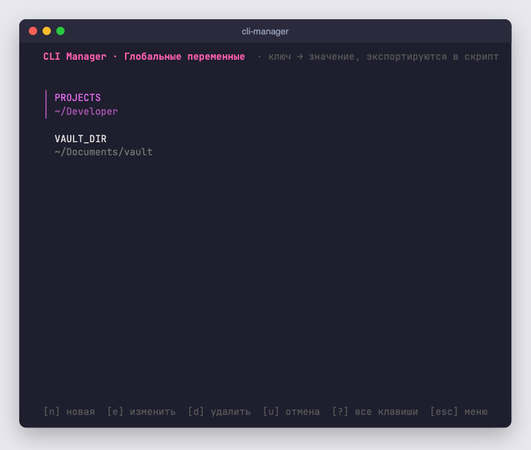

Переменные экспортируются в начале скрипта и доступны во всех действиях как
`${ИМЯ}`. Ведущая `~` в значении раскрывается в `$HOME`:

```zsh
export VAULT_DIR="$HOME/Documents/vault"
```

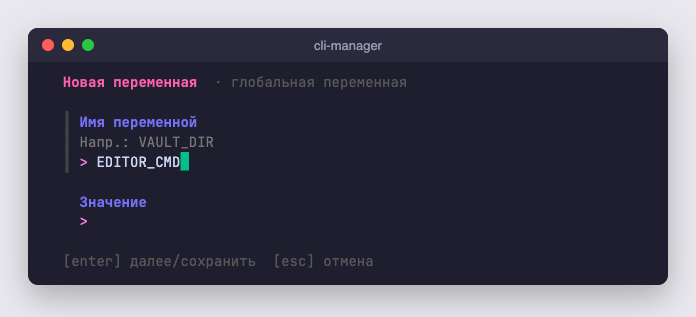

Клавиши те же, что в других списках: `n`, `e`, `d`, `u`, `/`.

### 3.8. Поиск

`/` в любом списке открывает строку поиска по имени. `Enter` применяет фильтр,
`Esc` — сбрасывает.

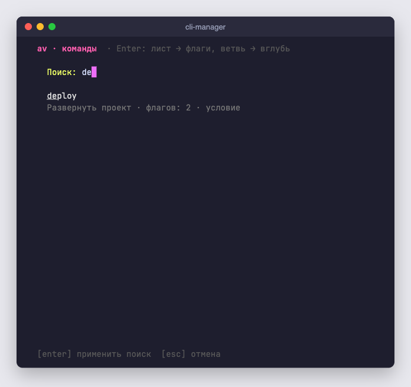

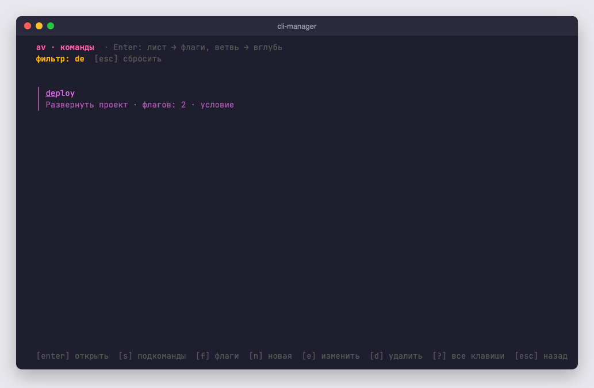

### 3.9. Выключение, дублирование, удаление, порядок, отмена

**Выключение (`x`).** Элемент остаётся в конфиге, но не попадает в скрипт.
Выключенный префикс не генерирует функцию, выключенная команда — вместе со
всеми вложенными. Повторное `x` включает обратно.

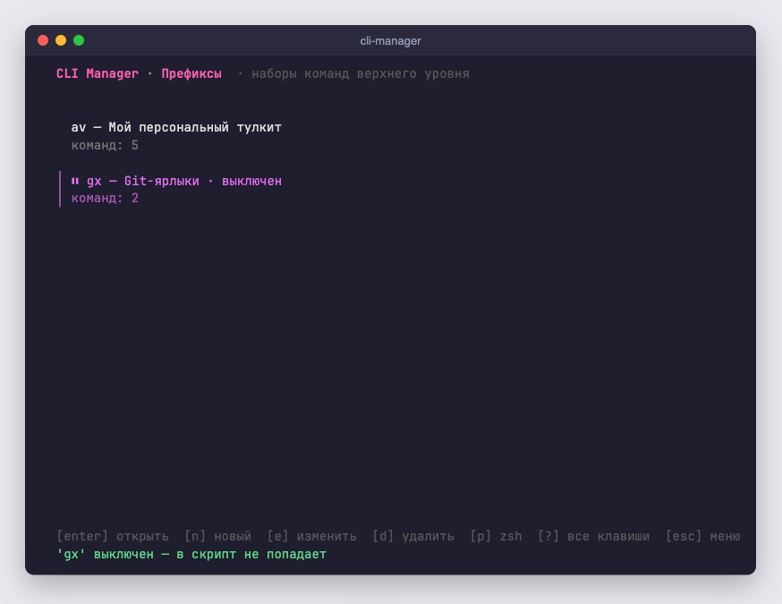

**Дублирование (`c`).** Копия появляется сразу под оригиналом с уникальным
именем: префикс — `имя_copy`, команда и флаг — `имя-copy` (далее `-copy2` …).
Команда копируется со всеми флагами и подкомандами.

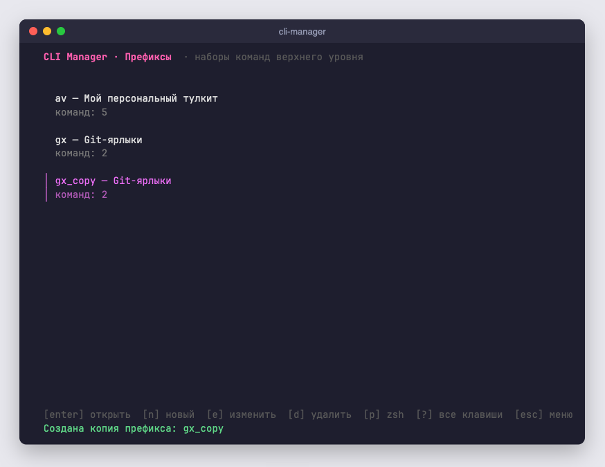

**Удаление (`d`)** всегда спрашивает подтверждение: `y` — удалить, `n` — отмена.

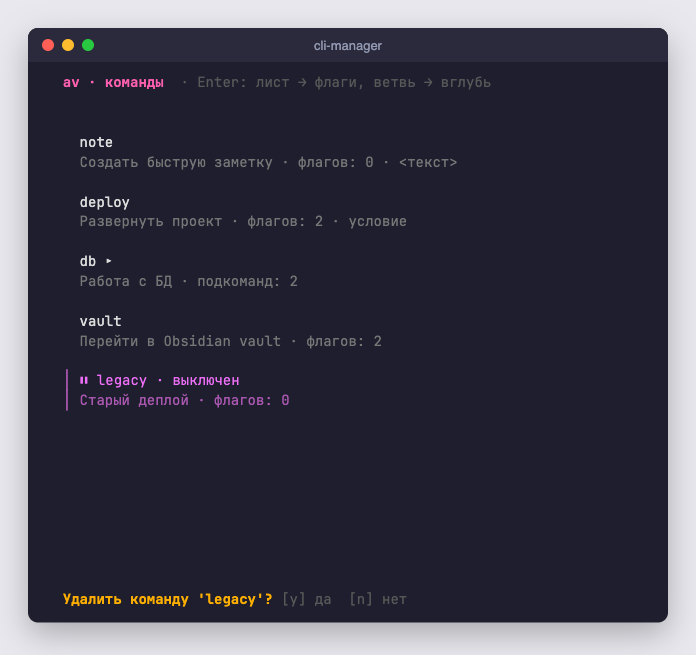

**Порядок (`K`/`J` или `Shift+↑/↓`).** Порядок влияет на справку и
автодополнение.

**Отмена (`u`).** Откатывает последнее изменение — создание, правку, удаление,
перемещение, выключение, дублирование, импорт. Глубина — 50 шагов в пределах
сессии.

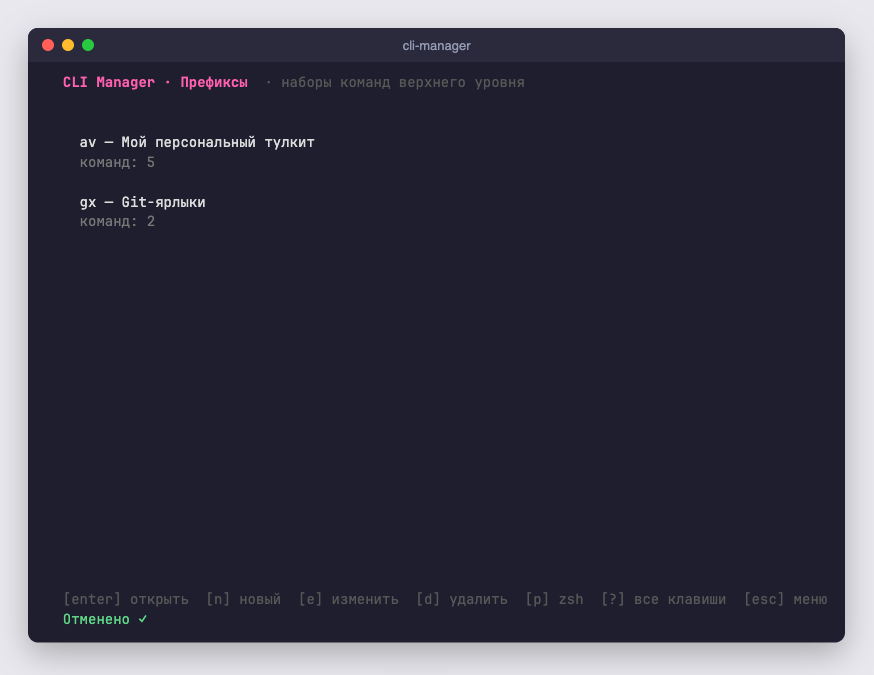

Каждое изменение сразу сохраняется на диск и перегенерирует скрипт.

### 3.10. Импорт alias из rc-файла

`i` в списке префиксов разбирает rc-файл текущей оболочки (`~/.zshrc` для zsh,
`~/.bashrc` для bash; для zsh учитывается `$ZDOTDIR`) и складывает найденные
`alias` командами в префикс-контейнер **`imported`**:

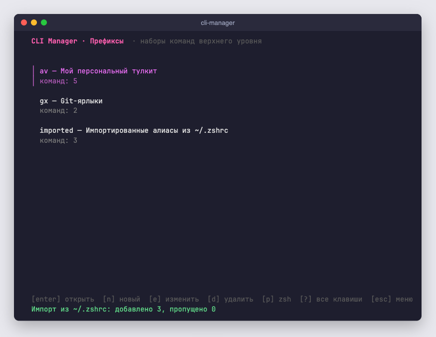

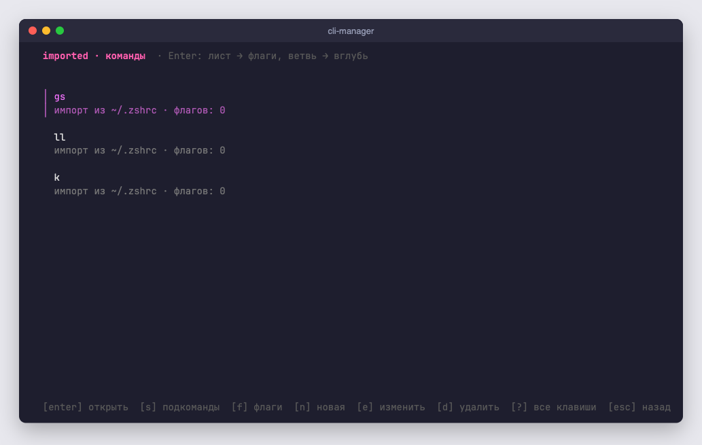

После импорта `imported gs` выполняет `git status`. Имена, недопустимые для
команд, и уже импортированные пропускаются — статус показывает, сколько
добавлено и пропущено. Импорт отменяется по `u`.

### 3.11. Предпросмотр скрипта

- `p` на префиксе или команде — код одного префикса;
- пункт главного меню **«Предпросмотр всего скрипта»** — весь файл.

`↑/↓` — прокрутка, `Esc` — назад. В шапке — путь к итоговому файлу.

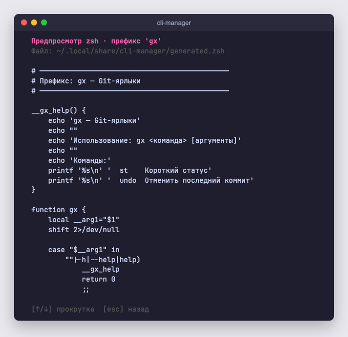

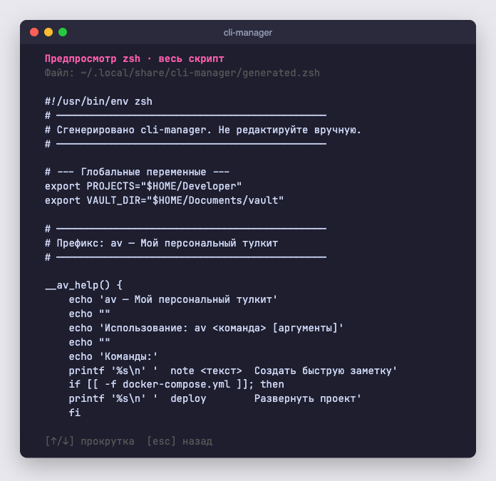

### 3.12. Выбор оболочки (zsh / bash)

Пункт **«Оболочка»** в главном меню переключает целевую оболочку. Сразу после
переключения скрипт генерируется для новой оболочки
(`generated.zsh` ↔ `generated.bash`), а меню напоминает, если новый файл ещё
не подключён в соответствующем rc-файле (см. скриншот в [3.1](#31-главное-меню)).

| | zsh | bash |
|---|---|---|
| Автодополнение | `compdef` / `_arguments` | `complete -F` / `compgen` |
| Перезагрузка | хук `precmd` | `PROMPT_COMMAND` |
| Файл | `generated.zsh` | `generated.bash` |
| rc-файл | `~/.zshrc` (`$ZDOTDIR`) | `~/.bashrc` |

Диспетчер, справка и условия одинаковы для обеих оболочек.

### 3.13. Справка по клавишам

`?` в любом месте открывает полный список клавиш:

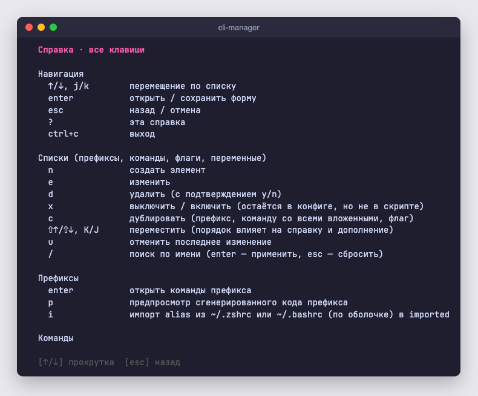

Сводная таблица:

| Клавиша | Действие |
|---|---|
| `↑/↓`, `j/k` | навигация |
| `Enter` | открыть / далее / сохранить |
| `Esc` | назад / отмена |
| `n` / `e` / `d` | создать / изменить / удалить |
| `x` | выключить / включить |
| `c` | дублировать |
| `K/J`, `Shift+↑/↓` | переместить |
| `u` | отменить последнее изменение |
| `/` | поиск |
| `s`, `→` | войти в подкоманды |
| `f` | флаги команды |
| `p` | предпросмотр кода префикса |
| `i` | импорт alias (в списке префиксов) |
| `Ctrl+T` | тестовый запуск кода (в форме) |
| `Ctrl+E` | внешний редактор (в поле действия) |
| `?` | справка |
| `q` | выход (в главном меню) |
| `Ctrl+C` | выход откуда угодно |

---

## 4. Веб-интерфейс (`cli-manager ui`)

Веб-интерфейс показывает всё дерево команд на одном экране. Он работает
локально, ничего дополнительно ставить не нужно.

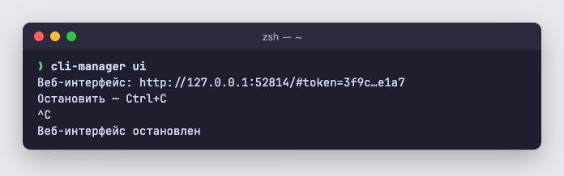

```bash
cli-manager ui              # любой свободный порт, браузер откроется сам
cli-manager ui --port 8080  # фиксированный порт
cli-manager ui --no-open    # только напечатать адрес
```

Сервер работает, пока не нажать `Ctrl+C`.

### 4.1. Устройство экрана

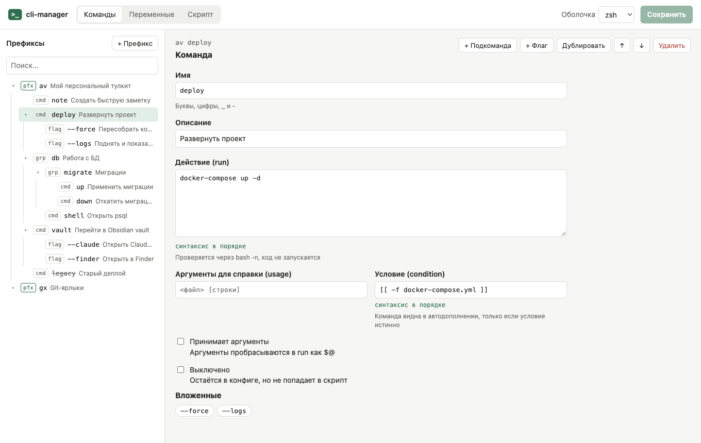

- **Шапка:** вкладки **Команды / Переменные / Скрипт**, выбор оболочки,
  индикатор «не сохранено» и кнопка **Сохранить** (`⌘S` / `Ctrl+S`).
- **Слева — дерево.** Метки узлов: `pfx` — префикс, `grp` — команда-ветвь,
  `cmd` — команда-лист, `flag` — флаг. Выключенные элементы зачёркнуты,
  элементы с ошибками помечены красной точкой. `▸` / `▾` сворачивает и
  разворачивает ветку; узлы доступны с клавиатуры (`Tab`, `Enter`, `Пробел`).
- **Справа — форма выбранного узла.** Сверху путь (`av deploy`) и панель
  действий: **+ Команда / + Подкоманда**, **+ Флаг**, **Дублировать**,
  **↑ / ↓** (порядок), **Удалить**. Внизу — блок **«Вложенные»** с кнопками
  быстрого перехода к дочерним узлам.

Пока ничего не выбрано, справа подсказка «Выберите узел в дереве слева»
(а при пустом конфиге — кнопка «+ Добавить префикс»).

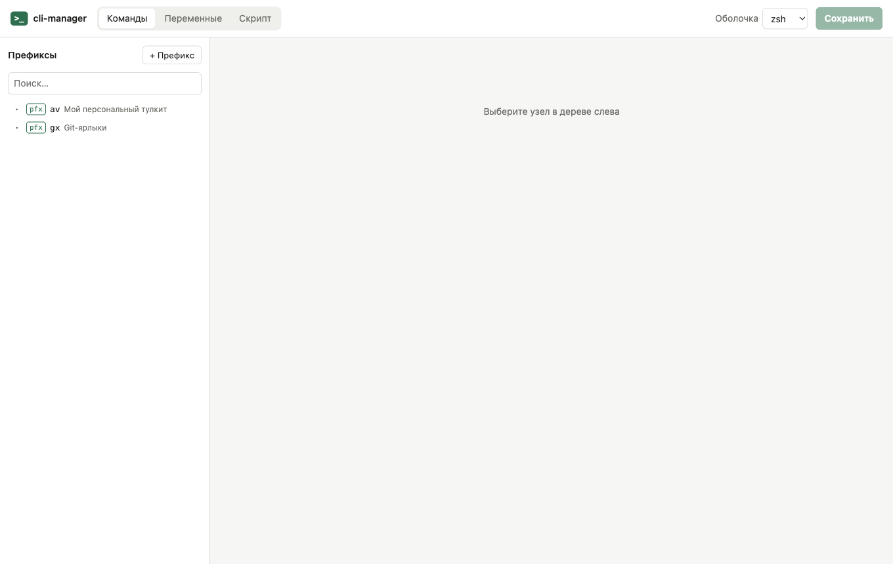

### 4.2. Формы узлов

Набор полей тот же, что в TUI.

**Флаг** — с галочкой «Сначала выполнить действие команды» (`after_command`):

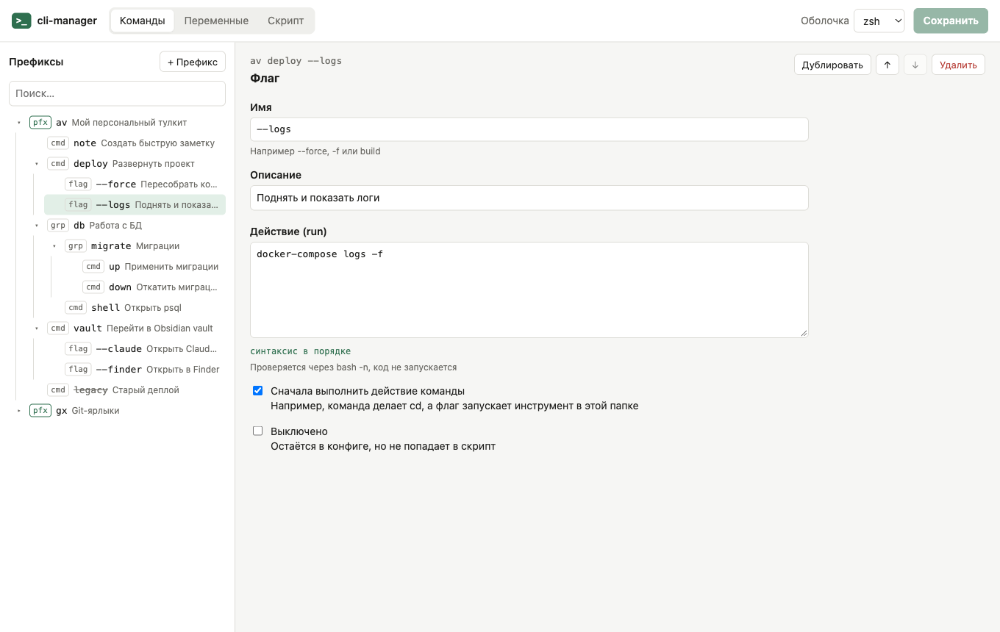

**Группа команд (ветвь)** — у неё `run` выполняется без подкоманды и если
подкоманда не распознана. Флаги у группы работают наравне с подкомандами.

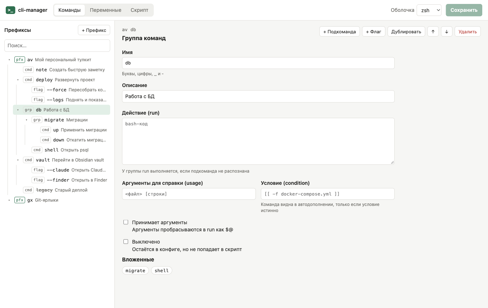

В поле кода `Tab` вставляет табуляцию (`Shift+Tab` уводит фокус).

### 4.3. Живые проверки

Как и в TUI, поля проверяются на сервере во время ввода — код **не
выполняется**, только `bash -n`. В веб-интерфейсе нет тестового запуска
(`Ctrl+T`) — это сделано намеренно.

Ошибка синтаксиса в действии:

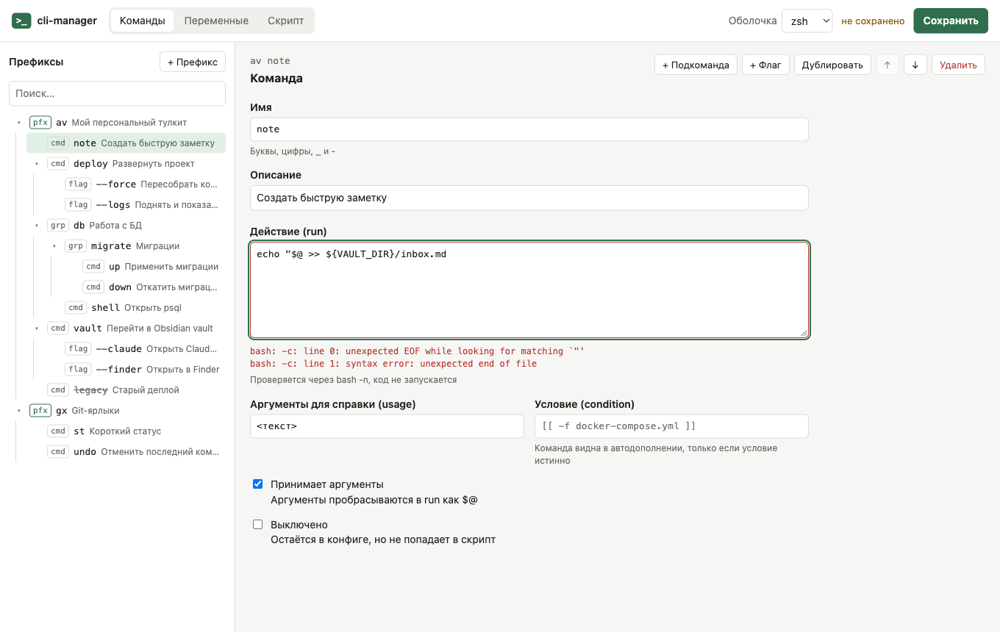

Коллизия имени префикса с системной командой и с alias:

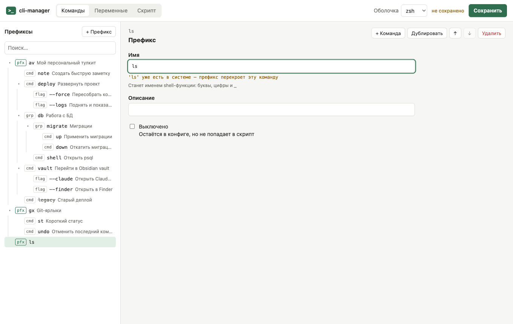

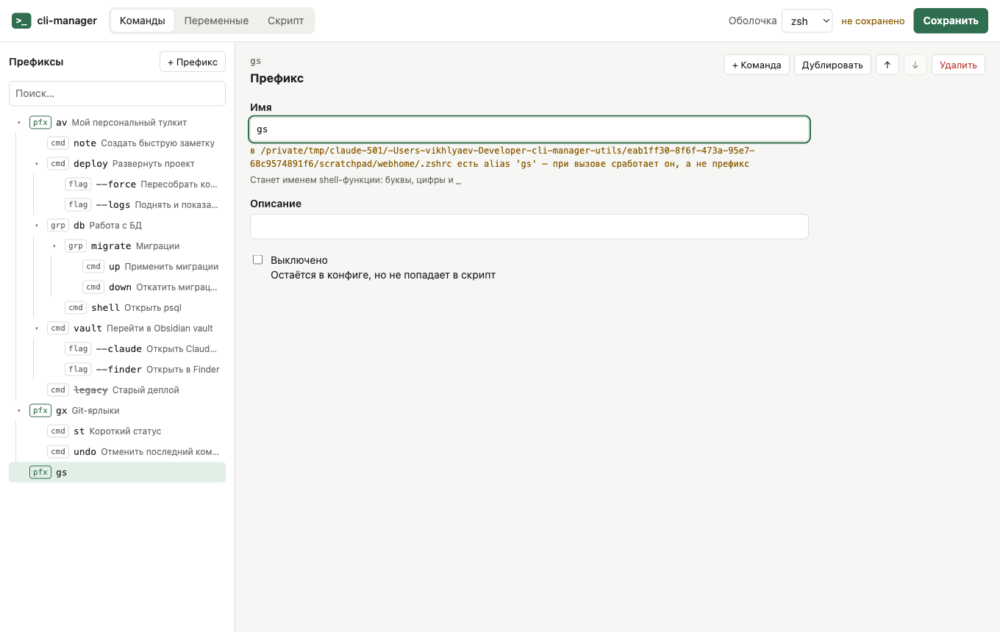

Поля «Условие» тоже проверяются на синтаксис; правильное поле помечается
«синтаксис в порядке».

### 4.4. Ошибки в конфиге

Конфиг проверяется целиком прямо во время правки. Как только в нём появляется
ошибка, внизу открывается панель со списком проблем — щелчок по пути переносит
к нужному узлу, узел в дереве помечается красной точкой, а в его форме сверху
появляется жёлтая плашка. Пока ошибки есть, конфиг **не сохраняется**.

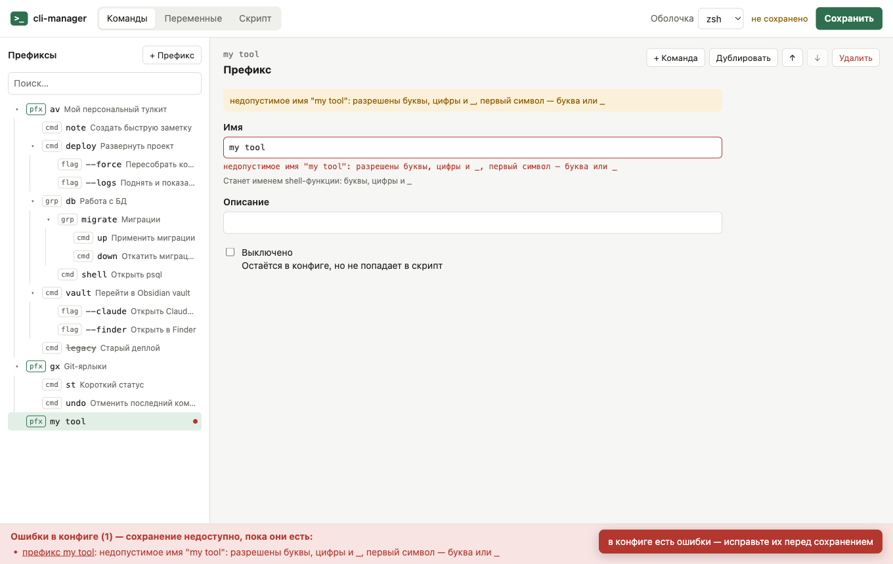

### 4.5. Создание и поиск

Новые узлы создаются кнопками **+ Префикс**, **+ Команда**, **+ Подкоманда**,
**+ Флаг**. Изменения живут в браузере до нажатия **Сохранить** — индикатор
«не сохранено» и `●` в заголовке вкладки напоминают о них. Закрыть вкладку с
несохранёнными правками браузер не даст без подтверждения.

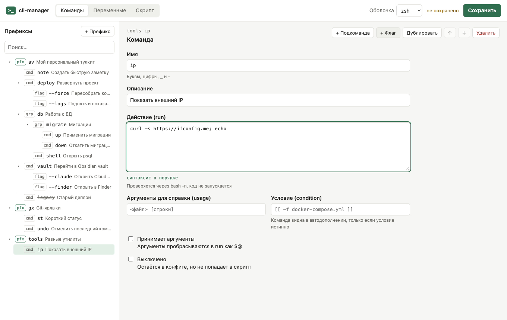

Поле **«Поиск…»** над деревом фильтрует узлы по имени; родители найденных
узлов показываются и разворачиваются автоматически.

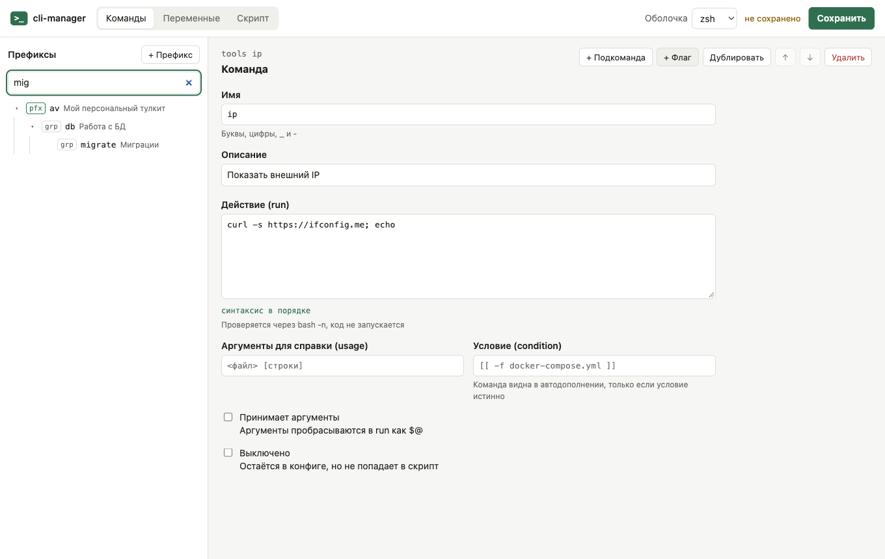

### 4.6. Переменные

Вкладка **Переменные** — таблица `имя → значение` с проверкой имени: пустое
или недопустимое имя подсвечивается как ошибка, а для повторяющегося имени
выводится предупреждение (сохранится последнее значение). Кнопка **✕**
удаляет переменную.

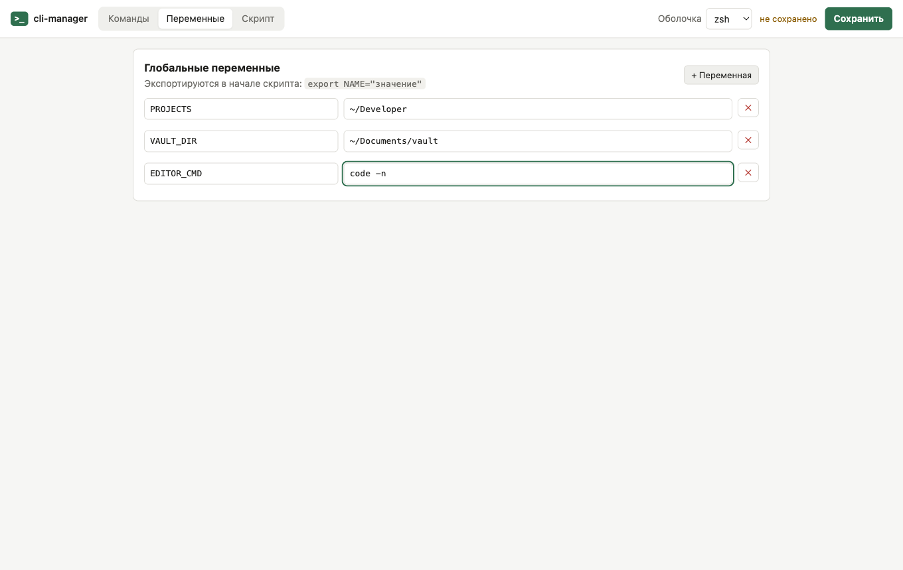

### 4.7. Превью скрипта

Вкладка **Скрипт** показывает, что будет сгенерировано из **текущего,
ещё не сохранённого** состояния, и путь к итоговому файлу. Кнопка
**Копировать** копирует скрипт в буфер обмена. При смене оболочки в шапке
превью сразу перестраивается.

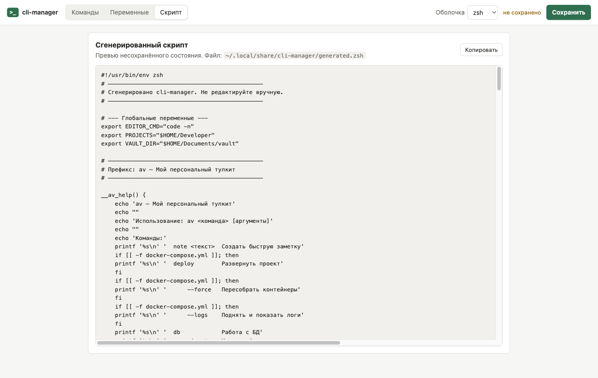

### 4.8. Сохранение

**Сохранить** (или `⌘S` / `Ctrl+S`) записывает конфиг и перегенерирует скрипт:

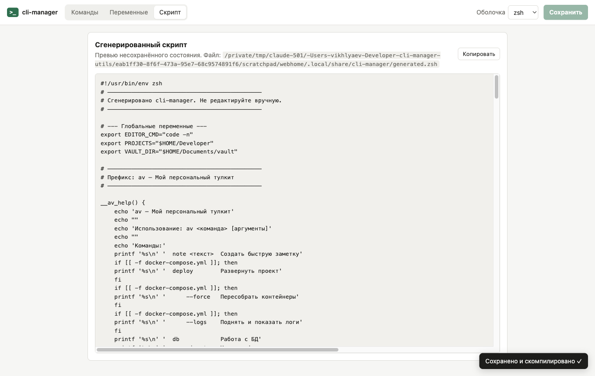

Если конфиг сохранён, а скрипт сгенерировать не удалось (например, ошибка
синтаксиса в действии), появится баннер: прежний рабочий скрипт остаётся на
месте.

### 4.9. Конфликт с правками из TUI или вручную

Если пока вы работали в браузере, `config.yaml` изменили в TUI или вручную,
сохранение будет отклонено — чужие правки не затрутся. Баннер предложит
загрузить версию с диска (ваши несохранённые правки при этом пропадут).

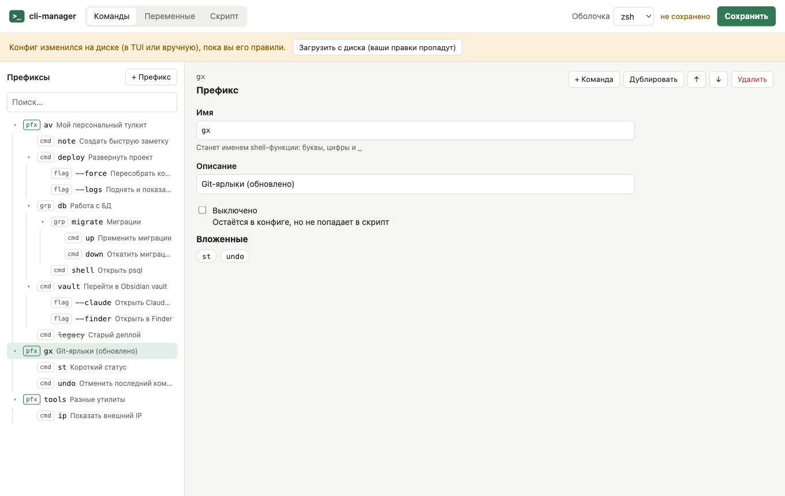

### 4.10. Безопасность

- Сервер слушает только `127.0.0.1`.
- Доступ к API — по случайному токену из ссылки, которую печатает
  `cli-manager ui`. Без токена страница покажет «Нет токена доступа».
  После загрузки токен убирается из адресной строки и хранится в
  `sessionStorage` вкладки.
- Принимаются только запросы с `Host`/`Origin` вида `127.0.0.1:порт` или
  `localhost:порт` — защита от DNS rebinding.
- Строгий `Content-Security-Policy`, запрет встраивания во фреймы, лимит тела
  запроса 1 МБ.
- Код из браузера никогда не выполняется — только `bash -n`.

---

## 5. Командная строка

Без аргументов `cli-manager` открывает TUI, с аргументом выполняет подкоманду.

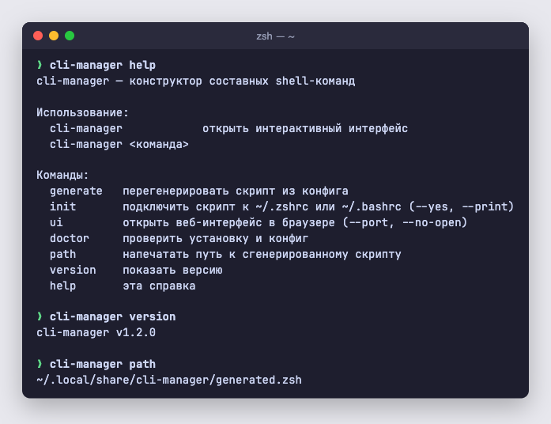

| Команда | Что делает |
|---|---|
| `generate` | перегенерировать скрипт из конфига (после ручной правки YAML) |
| `init` | подключить скрипт к rc-файлу оболочки |
| `ui` | открыть веб-интерфейс (`--port`, `--no-open`) |
| `doctor` | проверить конфиг, скрипт, подключение, compinit и коллизии |
| `path` | напечатать путь к сгенерированному скрипту |
| `version` | показать версию (также `--version`, `-v`) |
| `help` | список команд (также `--help`, `-h`) |

Неизвестная подкоманда печатает справку в stderr и завершается с кодом 2.

### 5.1. `generate`

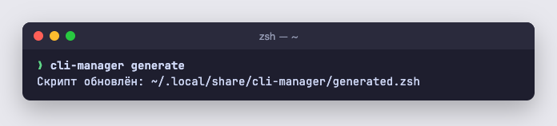

Если в конфиге есть проблемы, они выводятся как предупреждения. При ошибке
генерации код выхода — 1, прежний скрипт остаётся нетронутым.

### 5.2. `init`

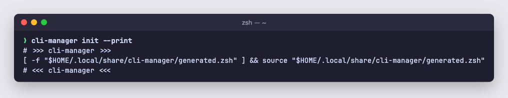

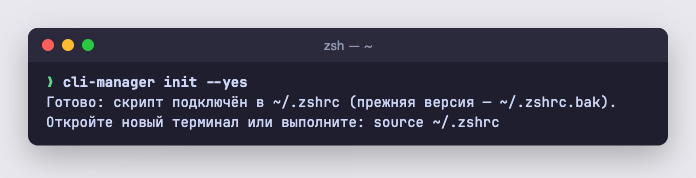

| Флаг | Поведение |
|---|---|
| (без флагов) | показать блок и спросить подтверждение |
| `--yes` | дописать без вопросов |
| `--print` | только напечатать блок — вставить вручную |

Перед изменением rc-файла сохраняется бэкап `.bak`. Если скрипт уже подключён
(блоком или своей строкой `source`), `init` ничего не меняет.

На macOS терминал запускает login-bash, который читает `~/.bash_profile`. Он
должен подключать `~/.bashrc` (`[ -f ~/.bashrc ] && . ~/.bashrc`) — `doctor`
это проверяет.

### 5.3. `doctor`

Проверяет установку целиком и печатает отчёт:

- ✓ — проверка пройдена;
- ⚠ — предупреждение (на код выхода не влияет);
- ✗ — ошибка (код выхода 1).

Что проверяется: конфиг читается и не содержит ошибок; целевая оболочка
есть в `PATH`; скрипт существует и не старше конфига; скрипт подключён в
rc-файле; для zsh — есть compinit и подключение стоит после него; для bash на
macOS — `~/.bash_profile` подключает `~/.bashrc`; имена префиксов не
перекрывают команды и alias.

Пример отчёта с ошибками:

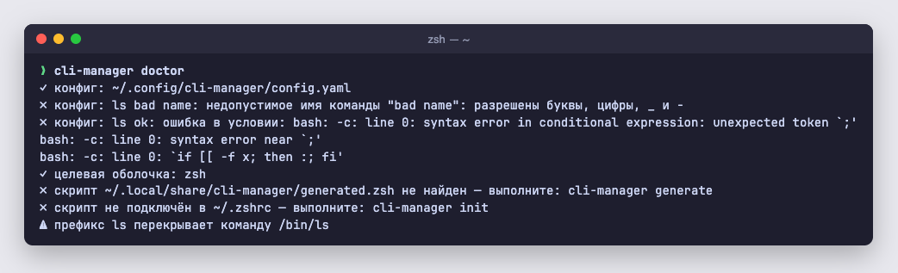

### 5.4. `path`

Печатает путь к скрипту. Удобно, если вы подключаете скрипт сами:

```zsh
source "$(cli-manager path)"
```

---

## 6. Как работает сгенерированный скрипт

### 6.1. Встроенная справка

Префикс без аргументов, с `-h`, `--help` или `help` печатает дерево команд.
Справка есть на каждом уровне вложенности (`av db --help`). Исключение —
ветвь со своим `run`: без подкоманды (`av mb`) она выполняет это действие,
а справку показывает только по `-h`/`--help`/`help`:

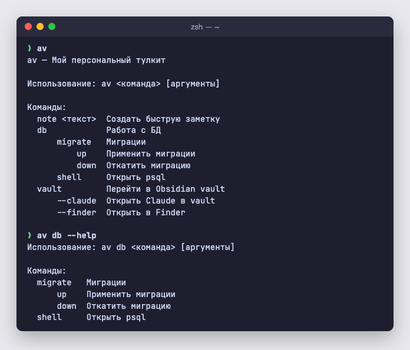

Неизвестная команда печатает ту же справку в stderr и возвращает код 1:

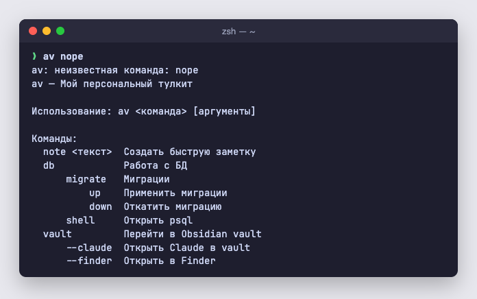

### 6.2. Автодополнение

`av <Tab>` предлагает команды с описаниями, `av db <Tab>` — подкоманды,
`av deploy <Tab>` — флаги. Выключенные элементы и команды, чьё условие ложно,
в дополнение не попадают.

### 6.3. Авто-перезагрузка в открытых терминалах

Править команды можно, не перезапуская терминалы. Скрипт регистрирует хук
(`precmd` в zsh, `PROMPT_COMMAND` в bash). Перед каждым приглашением хук
сравнивает метку поколения из `generated.<sh>.stamp` со своей. Если скрипт
перегенерирован, хук снимает функции прежних префиксов (удалённые исчезают) и
заново подключает скрипт. Метка — хеш текста скрипта, поэтому повторная
генерация без изменений перезагрузки не вызывает. Код возврата последней
команды (`$?`) хук сохраняет.

---

## 7. Флаги: замена или дополнение действия

По умолчанию флаг **заменяет** действие команды: `av deploy --force` выполнит
только `run` флага.

Если флагу сначала нужно то, что делает сама команда, включите
`after_command` (в TUI — «Сначала выполнить действие команды?», в веб — галочка).
Типичный случай: команда делает `cd`, а флаг запускает инструмент в этой папке.

```yaml
- name: vault
  run: cd ${VAULT_DIR}
  flags:
    - name: --claude
      after_command: true     # cd ${VAULT_DIR}, затем claude
      run: claude
    - name: --finder
      after_command: true     # cd ${VAULT_DIR}, затем open .
      run: open .
```

Действие команды выполняется в текущей оболочке, поэтому `cd` остаётся в силе.
Если оно завершилось ошибкой (например, папки нет), флаг не запускается.

---

## 8. Контекстные условия (`condition`)

Условие — bash-выражение, которое проверяется в момент вызова справки и
автодополнения. Команда (вместе с её флагами) показывается, только если оно
истинно.

```yaml
- name: deploy
  run: docker-compose up -d
  condition: "[[ -f docker-compose.yml ]]"
```

В папке без `docker-compose.yml` команды `deploy` нет ни в справке, ни в
дополнении (см. [6.1](#61-встроенная-справка)). В папке проекта она появляется:

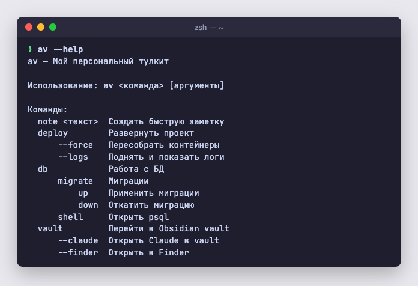

Синтаксис условия проверяется при вводе (в TUI и вебе) и в `doctor`.

---

## 9. Аргументы команд

Всё, что указано после команды, доступно в её `run` как обычные позиционные
параметры оболочки: `$1`, `$2`, …, `"$@"`, `$#`.

- **Подстановка по номеру** — пишите `$1` прямо в нужном месте `run`:
  `rake loc="$1"` → `av mb loc profile` выполнит `rake loc=profile`.
- **`accepts_args: true`** — если `run` не обращается к аргументам сам
  (нет `$1`, `$@`, `$*`, `$#`), они дописываются в конец как `"$@"`:
  `av note купить молоко` → `echo купить молоко`. Ещё эта галочка включает
  дополнение имён файлов по Tab.
- **`usage`** — описание аргументов для справки, например `<файл> [строки]`.
  Аргументы в `<…>` **обязательны**: если их не хватает, команда не
  запускается, а печатает подсказку и возвращает код 2. Аргументы в `[…]`
  необязательны.

### 9.1. Подкоманда в папке родителя (`after_command`)

У подкоманды, как у флага, есть `after_command` (в TUI — «Сначала выполнить
действие родительской команды?», в веб — галочка): сначала выполняется `run`
родителя, затем свой. Типичный случай — родитель делает `cd` в проект, а
подкоманда запускает там инструмент с аргументом:

```yaml
- name: mb
  run: cd ~/work/mb             # av mb — просто перейти в папку
  subcommands:
    - name: loc
      description: Собрать локализацию
      usage: "<файл>"
      after_command: true       # сначала cd ~/work/mb
      run: rake loc="$1"        # av mb loc profile → rake loc=profile
```

Аргументы проверяются до `cd`: `av mb loc` без имени файла ничего не
выполнит. Если `run` родителя завершился ошибкой, подкоманда не запускается.

---

## 10. Проверки и защита от ошибок

| Что | Где | Как |
|---|---|---|
| Формат и уникальность имён | формы TUI и веб, `doctor`, запуск TUI | блокирует сохранение формы / веб-конфига |
| Синтаксис `run` | формы, генерация | `bash -n` при вводе; перед заменой скрипт проверяется `zsh -n` / `bash -n` |
| Синтаксис `condition` | формы, `doctor` | `bash -n` |
| Коллизии префиксов | формы, `doctor` | `command -v` и alias из rc-файла |
| Целостность файлов | при каждой записи | атомарная запись (временный файл + rename) |
| Бэкап конфига | при каждой записи | предыдущая версия → `config.yaml.bak` |
| Бэкап rc-файла | `init` | `~/.zshrc.bak` / `~/.bashrc.bak` |
| Одновременная правка | веб-интерфейс | сохранение отклоняется, если файл изменился на диске |

Главный принцип: **сломанный скрипт никогда не заменяет рабочий**. Если новый
скрипт не проходит проверку синтаксиса, на диске остаётся прежний.

---

## 11. Файлы и их расположение

| Файл | Назначение |
|---|---|
| `~/.config/cli-manager/config.yaml` | конфигурация |
| `~/.config/cli-manager/config.yaml.bak` | предыдущая версия конфига |
| `~/.local/share/cli-manager/generated.zsh` | скрипт для zsh |
| `~/.local/share/cli-manager/generated.bash` | скрипт для bash |
| `~/.local/share/cli-manager/generated.<sh>.stamp` | метка поколения для авто-перезагрузки |
| `~/.zshrc` (`$ZDOTDIR/.zshrc`) / `~/.bashrc` | сюда `init` дописывает подключение |

Блок подключения, который дописывает `init`:

```zsh
# >>> cli-manager >>>
[ -f "$HOME/.local/share/cli-manager/generated.zsh" ] && source "$HOME/.local/share/cli-manager/generated.zsh"
# <<< cli-manager <<<
```

---

## 12. Ручная правка конфига

`config.yaml` можно править в любом редакторе. После правки:

```bash
cli-manager doctor
```

```bash
cli-manager generate
```

Или просто откройте TUI — он проверит конфиг и перегенерирует скрипт сам.
Если в конфиге ошибки, главное меню покажет их число и первую из них.

---

## 13. Справочник полей конфигурации

**Корень**

| Поле | Тип | Описание |
|---|---|---|
| `shell` | `zsh` \| `bash` | целевая оболочка; по умолчанию `zsh` |
| `variables` | map | глобальные переменные `ИМЯ: значение` |
| `prefixes` | list | префиксы |

**Префикс**

| Поле | Обязательно | Описание |
|---|---|---|
| `name` | да | имя функции: буквы, цифры, `_`; первый символ — не цифра |
| `description` | | описание для справки |
| `commands` | | команды |
| `disabled` | | `true` — не генерировать |

**Команда**

| Поле | Обязательно | Описание |
|---|---|---|
| `name` | да | буквы, цифры, `_` и `-` |
| `description` | | описание для справки и дополнения |
| `run` | для листа | bash-код действия; у ветви — действие по умолчанию |
| `usage` | | описание аргументов для справки; `<…>` — обязательные |
| `accepts_args` | | дописать аргументы в конец `run` как `"$@"` (если в `run` нет `$1`/`$@`) и дополнять файлы |
| `after_command` | | для подкоманды: сначала выполнить `run` родителя |
| `condition` | | bash-условие видимости |
| `flags` | | флаги; у ветви работают вместе с `subcommands` |
| `subcommands` | | вложенные команды любой глубины |
| `disabled` | | `true` — не генерировать (вместе с вложенными) |

**Флаг**

| Поле | Обязательно | Описание |
|---|---|---|
| `name` | да | например `--force`, `-f`, `build` |
| `description` | | описание |
| `run` | да | bash-код действия |
| `after_command` | | сначала выполнить действие команды |
| `disabled` | | `true` — не генерировать |

---

## 14. Пример конфигурации

Конфиг, на котором сняты все скриншоты:

```yaml
variables:
  VAULT_DIR: "~/Documents/vault"
  PROJECTS: "~/Developer"

prefixes:
  - name: av
    description: "Мой персональный тулкит"
    commands:
      - name: note
        description: "Создать быструю заметку"
        usage: "<текст>"
        run: "echo \"$@\" >> ${VAULT_DIR}/inbox.md"
        accepts_args: true

      - name: deploy
        description: "Развернуть проект"
        run: "docker-compose up -d"
        condition: "[[ -f docker-compose.yml ]]"
        flags:
          - name: --force
            description: "Пересобрать контейнеры"
            run: "docker-compose up -d --build"
          - name: --logs
            description: "Поднять и показать логи"
            after_command: true
            run: "docker-compose logs -f"

      - name: db
        description: "Работа с БД"
        subcommands:
          - name: migrate
            description: "Миграции"
            subcommands:
              - name: up
                description: "Применить миграции"
                run: "migrate -path ./migrations up"
              - name: down
                description: "Откатить миграцию"
                run: "migrate -path ./migrations down 1"
          - name: shell
            description: "Открыть psql"
            run: "psql \"$DATABASE_URL\""

      - name: vault
        description: "Перейти в Obsidian vault"
        run: "cd ${VAULT_DIR}"
        flags:
          - name: --claude
            description: "Открыть Claude в vault"
            after_command: true
            run: "claude"
          - name: --finder
            description: "Открыть в Finder"
            after_command: true
            run: "open ."

      - name: legacy
        description: "Старый деплой"
        run: "./old-deploy.sh"
        disabled: true

  - name: gx
    description: "Git-ярлыки"
    commands:
      - name: st
        description: "Короткий статус"
        run: "git status -sb"
      - name: undo
        description: "Отменить последний коммит"
        run: "git reset --soft HEAD~1"
```

Что получается в терминале:

```text
av note купить молоко   → дописать строку в ~/Documents/vault/inbox.md
av deploy               → docker-compose up -d (только в папке с docker-compose.yml)
av deploy --force       → docker-compose up -d --build
av deploy --logs        → docker-compose up -d, затем docker-compose logs -f
av db migrate up        → migrate -path ./migrations up
av vault --claude       → cd ~/Documents/vault, затем claude
av legacy               → нет такой команды (выключена)
gx st                   → git status -sb
```

---

## 15. Частые вопросы и решение проблем

**Команда не находится (`command not found: av`).**
Скрипт не подключён. Выполните `cli-manager init` и откройте новый терминал.
Проверьте `cli-manager doctor`.

**Не работает автодополнение в zsh.**
`doctor` подскажет: нет `compinit` или подключение cli-manager стоит раньше
него. Блок cli-manager должен идти после `compinit` (или после строки,
подключающей oh-my-zsh и подобные фреймворки).

**Изменения не видны в уже открытом терминале.**
Они подхватываются перед следующим приглашением — нажмите `Enter`. Если не
помогло, проверьте, что скрипт действительно перегенерирован: при ошибке
синтаксиса в действии статус-строка TUI (или баннер веб-интерфейса) сообщит,
что остался прежний скрипт.

**Префикс не срабатывает, вместо него выполняется что-то другое.**
Скорее всего, в rc-файле есть alias с тем же именем — alias срабатывает
раньше функции. `doctor` покажет такую коллизию. Переименуйте префикс или
удалите alias.

**Команда видна не везде.**
У неё задано условие (`condition`) — в списке команд TUI это отмечено словом
«условие».

**Веб-интерфейс пишет «Нет токена доступа».**
Откройте ссылку целиком, как её напечатала `cli-manager ui` (с `#token=…`).
При каждом запуске сервера токен новый.

**Веб-интерфейс не сохраняет: «Конфиг изменился на диске».**
Конфиг правили в TUI или вручную. Нажмите «Загрузить с диска» и повторите
правки.

**Где взять старую версию конфига?**
В `~/.config/cli-manager/config.yaml.bak` — версия до последней записи. В
рамках сессии TUI можно откатываться по `u`.
